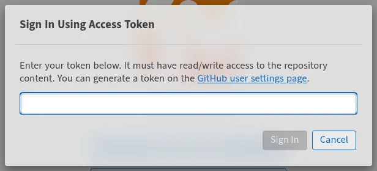
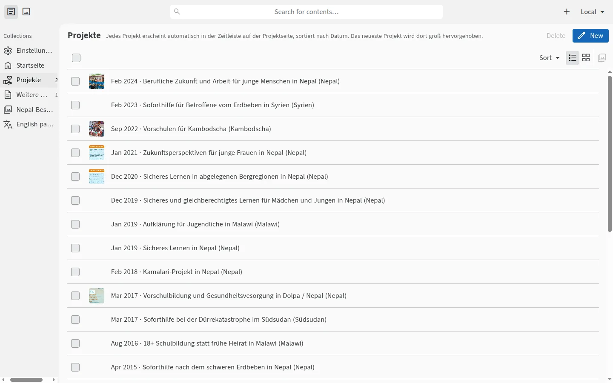
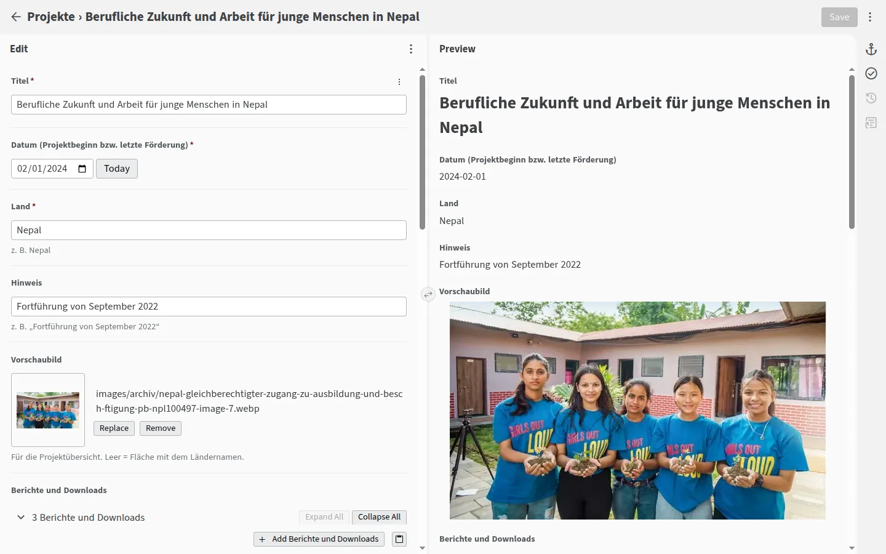
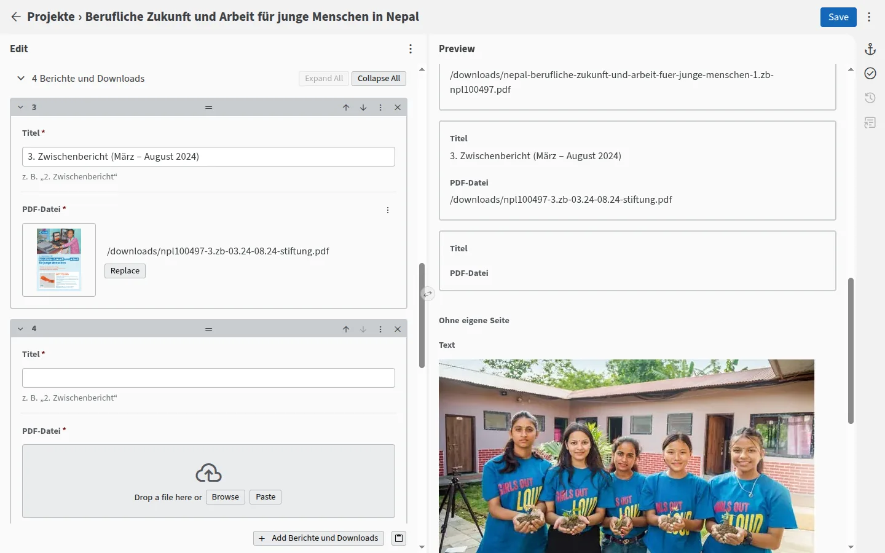
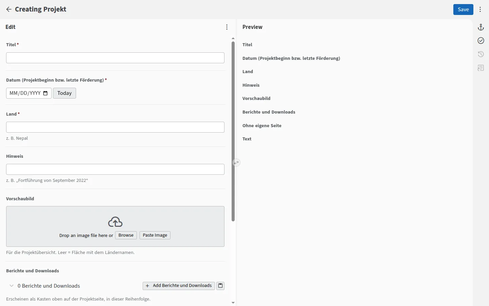
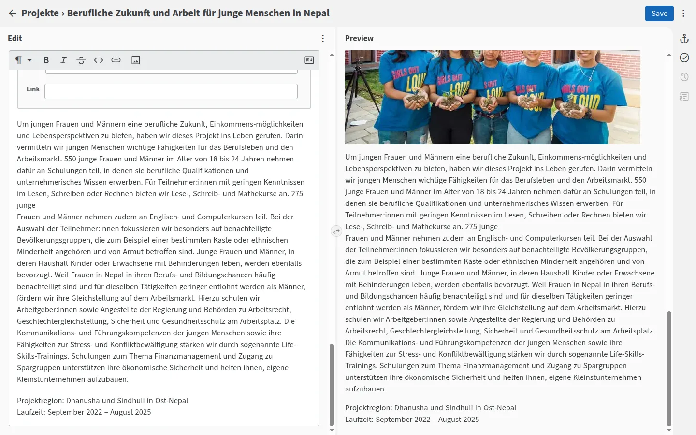
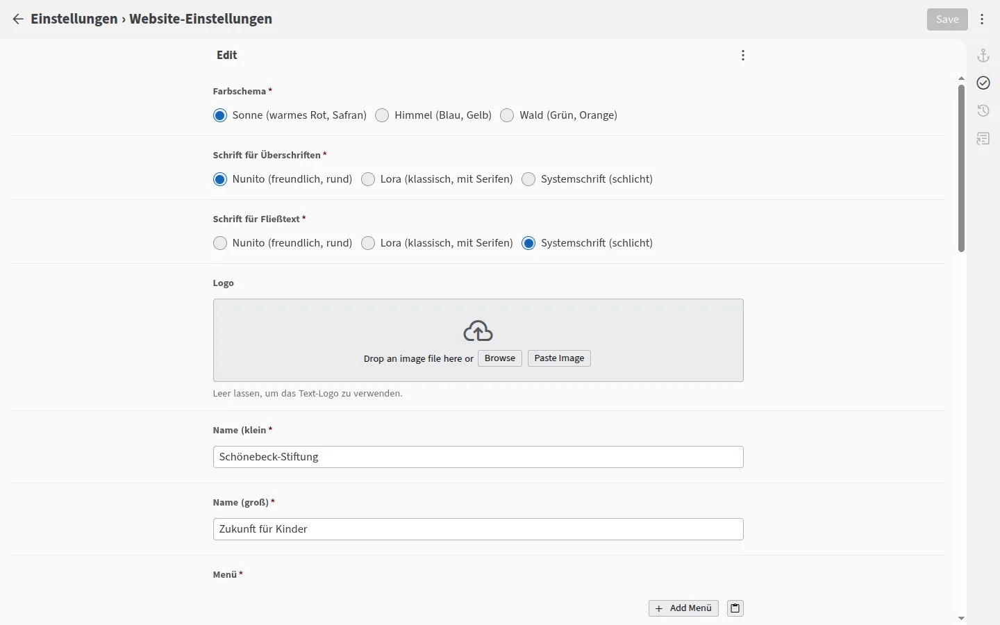

# Anleitung für die Redaktion

So ändern Sie Texte, Fotos und Berichte auf der Website von „Zukunft für
Kinder“. Sie brauchen dafür nur einen Browser (Chrome, Edge, Firefox oder
Safari). Kenntnisse in HTML oder Programmierung sind nicht nötig.

*English version: [editor-guide.md](editor-guide.md)*

**Redaktionsbereich:** <https://ne-o.github.io/zukunft-fuer-kinder/admin/>
(nach dem Umzug der Domain: `https://www.zukunft-fuer-kinder.net/admin/`)

> Die Bedienoberfläche ist auf Englisch, die Formulare sind auf Deutsch.
> Die englischen Begriffe stehen in dieser Anleitung **fett**, z. B.
> **Save** (Speichern).

## Inhalt
1. [Einmalig: Zugang einrichten](#1-einmalig-zugang-einrichten)
2. [Anmelden](#2-anmelden)
3. [Überblick](#3-überblick)
4. [Ein Projekt bearbeiten](#4-ein-projekt-bearbeiten)
5. [Einen Bericht (PDF) hochladen](#5-einen-bericht-pdf-hochladen)
6. [Ein neues Projekt anlegen](#6-ein-neues-projekt-anlegen)
7. [Texte und Fotos im Textfeld](#7-texte-und-fotos-im-textfeld)
8. [Andere Seiten und Einstellungen](#8-andere-seiten-und-einstellungen)
9. [Gut zu wissen](#9-gut-zu-wissen)

## 1. Einmalig: Zugang einrichten
Die Website liegt bei GitHub. Jede Person in der Redaktion meldet sich
mit einem eigenen GitHub-Konto an.

1. **GitHub-Konto anlegen** (kostenlos) unter <https://github.com/signup>,
   falls Sie noch keines haben.
2. **E-Mail-Adresse verbergen:** Jede Änderung wird mit Ihrem
   GitHub-Konto gespeichert und ist öffentlich einsehbar. Damit dabei
   nicht Ihre E-Mail-Adresse erscheint, öffnen Sie
   <https://github.com/settings/emails> und setzen Sie den Haken bei
   **Keep my email addresses private**.
3. **Einladung annehmen:** Teilen Sie Ihren GitHub-Benutzernamen der
   Person mit, die die Website technisch betreut. Sie erhalten dann eine
   E-Mail von GitHub mit einer Einladung zum Projekt
   `ne-o/zukunft-fuer-kinder` - bitte annehmen (**Accept invitation**).
4. **Zugangsschlüssel (Token) erstellen:** Öffnen Sie
   <https://github.com/settings/tokens/new> (Menü: Settings -> Developer
   settings -> Personal access tokens -> **Tokens (classic)** ->
   **Generate new token (classic)**).
   - **Note:** ein Name zur Erinnerung, z. B. `Website Zukunft für Kinder`.
   - **Expiration:** ein Ablaufdatum, z. B. 1 Jahr. Notieren Sie es sich -
     danach erstellen Sie einen neuen Schlüssel (siehe
     [Gut zu wissen](#9-gut-zu-wissen)).
   - **Select scopes:** nur den Haken bei **public_repo** setzen (unter
     „repo“). Alle anderen Haken bleiben leer.
   - Unten auf **Generate token** klicken.
5. **Schlüssel kopieren:** GitHub zeigt den Schlüssel (beginnt mit
   `ghp_`) **nur ein einziges Mal** an. Kopieren Sie ihn sofort. Sie
   brauchen ihn gleich zum Anmelden; danach merkt sich Ihr Browser die
   Anmeldung. Bewahren Sie ihn wie ein Passwort auf (z. B. im
   Passwort-Manager) und geben Sie ihn niemandem weiter.

Bitte nehmen Sie die **„classic“**-Variante. Die andere Variante
(„fine-grained“) funktioniert für dieses Projekt nicht.

## 2. Anmelden
Öffnen Sie den Redaktionsbereich (Adresse oben) und klicken Sie auf
**Sign In Using Access Token**. Fügen Sie Ihren Schlüssel ein und klicken
Sie auf **Sign In**.

Beim nächsten Mal sind Sie im selben Browser normalerweise noch
angemeldet.

## 3. Überblick
Links stehen die Bereiche der Website:

| Bereich | Was Sie dort ändern |
|---|---|
| **Einstellungen** | Farben, Schriften, Logo, Menü, Kontaktdaten, Spendenkonto - für die ganze Website |
| **Startseite** | Texte, Fotos, Zahlen und Kacheln der Startseite |
| **Projekte** | ein Eintrag pro Projekt, mit Berichten (PDF) |
| **Weitere Seiten** | Vision, Wir, Ihre Hilfe, Kontakt, Impressum, Datenschutz usw. |
| **Nepal-Besuch 2016 (Unterseiten)** | die Seiten des Reiseberichts |
| **English pages** | die englischen Seiten |

Ein Klick auf einen Eintrag öffnet ihn. Mit dem Suchfeld oben finden Sie
Texte auf allen Seiten.

*(Die Bilder in dieser Anleitung stammen aus einer Testumgebung, daher
steht oben rechts „Local“. Bei Ihnen steht dort Ihr GitHub-Profilbild.)*

## 4. Ein Projekt bearbeiten
1. Links **Projekte** wählen, das Projekt anklicken.
2. Links stehen die Felder, rechts sehen Sie eine einfache Vorschau.
3. Ändern Sie, was nötig ist. Felder mit `*` sind Pflichtfelder.
4. Oben rechts auf **Save** klicken.

**Nach dem Speichern** ist die Änderung nach etwa **1-2 Minuten** auf der
Website zu sehen. Laden Sie die Seite dann neu (Taste F5).

Felder eines Projekts:
- **Titel**, **Land** - erscheinen in der Projektübersicht.
- **Datum** - bestimmt die Reihenfolge in der Zeitleiste auf der
  Projektseite. Das neueste Projekt wird dort groß hervorgehoben.
- **Hinweis** - kleiner Zusatz, z. B. „Fortführung von September 2022“.
- **Vorschaubild** - Foto für die Projektübersicht. Ohne Foto erscheint
  eine farbige Fläche mit dem Ländernamen.
- **Berichte und Downloads** - siehe nächster Abschnitt.
- **Ohne eigene Seite** - nur für Einträge, die in der Zeitleiste stehen
  sollen, aber keine eigene Projektseite haben. Normalerweise nicht
  anfassen.
- **Text** - der eigentliche Projekttext mit Fotos.

Mit dem Pfeil oben links (**←**) kommen Sie zurück zur Liste. Wenn Sie
nicht gespeichert haben, wird nichts geändert.

## 5. Einen Bericht (PDF) hochladen
1. Projekt öffnen und nach unten zu **Berichte und Downloads** scrollen.
2. Auf **Add Berichte und Downloads** klicken - unten erscheint ein neuer,
   leerer Eintrag.
3. **Titel** eintragen, z. B. „4. Zwischenbericht (September 2024 -
   Februar 2025)“.
4. Bei **PDF-Datei** die Datei in das graue Feld ziehen oder auf
   **Browse** klicken und sie auswählen.
5. Oben rechts auf **Save** klicken.

Die Berichte erscheinen als Kasten oben auf der Projektseite, in der
Reihenfolge der Liste. Mit den Pfeilen **↑ ↓** in der grauen Leiste
eines Eintrags ändern Sie die Reihenfolge, mit **✕** entfernen Sie ihn.

**Tipp:** Der Dateiname wird Teil der Adresse des PDFs. Benennen Sie die
Datei vor dem Hochladen sinnvoll, z. B.
`nepal-berufliche-zukunft-4-zwischenbericht.pdf` (ohne Umlaute und
Leerzeichen).

## 6. Ein neues Projekt anlegen
1. Links **Projekte** wählen, oben rechts auf **New** klicken.
2. Mindestens **Titel**, **Datum** und **Land** ausfüllen, dazu den
   **Text** und am besten ein **Vorschaubild**.
3. Oben rechts auf **Save** klicken.

Das Projekt erscheint automatisch in der Zeitleiste auf der Seite
„Projekte“, einsortiert nach dem Datum. Die Adresse der neuen Seite
entsteht aus dem Titel. Ändern Sie den Titel später, bleibt die Adresse
gleich.

## 7. Texte und Fotos im Textfeld
Das Feld **Text** funktioniert wie ein einfaches Textprogramm:

- Werkzeugleiste: **¶** Absatz/Überschrift, **B** fett, *I* kursiv,
  Link (Kettensymbol), Foto (Bildsymbol).
- **Link einfügen:** Text markieren, auf das Kettensymbol klicken,
  Adresse eintragen. Für Seiten dieser Website genügt der Teil hinter
  der Domain, z. B. `/projekte.html`.
- **Foto einfügen:** auf das Bildsymbol klicken und ein Foto hochladen.
  Tragen Sie immer eine kurze **Bildbeschreibung** ein (für blinde
  Menschen und Suchmaschinen).
- **Fotos als Galerie:** Mehrere Fotos direkt hintereinander im selben
  Absatz werden auf der Website als Galerie nebeneinander gezeigt. Ein
  Klick vergrößert sie.
- Fotos dürfen groß sein (z. B. direkt vom Handy): Sie werden beim
  Hochladen automatisch verkleinert. Je größer das Original, desto
  schärfer die Vergrößerung.

## 8. Andere Seiten und Einstellungen
- **Startseite** und **Weitere Seiten** bearbeiten Sie genauso wie ein
  Projekt. Neue allgemeine Seiten lassen sich hier nicht anlegen - nur
  neue Projekte. Bitte wenden Sie sich dafür an die technische Betreuung.
- **Einstellungen -> Website-Einstellungen** gelten für die **ganze**
  Website: Farbschema, Schriften, Logo, Menü, Spenden-Knopf, Kontakt und
  Spendenkonto. Die Farbschemata sind auf gute Lesbarkeit geprüft. Bitte
  ändern Sie hier nur nach Absprache.

## 9. Gut zu wissen
- **Jedes Speichern ist sofort öffentlich** (nach 1-2 Minuten). Es gibt
  keinen Entwurfsmodus. Sie können aber nichts dauerhaft kaputt machen:
  Jede frühere Fassung bleibt erhalten und kann von der technischen
  Betreuung wiederhergestellt werden.
- **Löschen:** Gelöschte Projekte oder Seiten verschwinden mitsamt ihrer
  Adresse; Links von anderen Websites darauf funktionieren dann nicht
  mehr. Bitte vorher absprechen.
- **E-Mail von GitHub „Run failed“:** Nach dem Speichern wird die Website
  automatisch geprüft. Findet die Prüfung z. B. einen Link, der ins Leere
  führt, wird die Änderung **nicht** veröffentlicht, und GitHub schickt
  Ihnen diese E-Mail. Die Website bleibt dann wie vorher. Leiten Sie die
  E-Mail an die technische Betreuung weiter, oder korrigieren Sie den
  Link und speichern Sie erneut.
- **Schlüssel abgelaufen:** Wenn die Anmeldung nicht mehr klappt oder
  das Speichern mit einer Fehlermeldung abbricht, ist meist der
  Schlüssel abgelaufen. Erstellen Sie einen neuen wie in
  [Abschnitt 1](#1-einmalig-zugang-einrichten), Schritte 4-5, und melden
  Sie sich damit an. Den alten können Sie unter
  <https://github.com/settings/tokens> löschen. GitHub erinnert Sie
  kurz vorher per E-Mail.
- **Fehlermeldung beim Speichern trotz neuem Schlüssel:** Bitte der
  technischen Betreuung Bescheid geben (mit einem Bildschirmfoto der
  Meldung).
- **Abmelden** (z. B. an einem fremden Computer): auf Ihr Profilbild oben
  rechts klicken -> **Sign Out**.
- **Datum:** Das Datumsfeld zeigt das Format Ihres Browsers (z. B.
  TT.MM.JJJJ). Mit **Today** setzen Sie das heutige Datum.
