# Working in GitHub Codespaces

The development container from `.devcontainer/` (Hugo, preview, opencode,
browser) can run in GitHub's cloud instead of on your computer. You work
in VS Code in your browser - **nothing to install**, only a GitHub account.
For working on your own computer instead: [DEVELOPMENT.md](../DEVELOPMENT.md).

Editors don't need any of this - texts, photos and reports are changed in
the CMS ([editor guide](editor-guide.md)).

## Contents
1. [What you need, what it costs](#1-what-you-need-what-it-costs)
2. [Create a codespace](#2-create-a-codespace)
3. [First start: trust the folder, allow opencode](#3-first-start-trust-the-folder-allow-opencode)
4. [opencode, the AI assistant](#4-opencode-the-ai-assistant)
5. [Preview the site](#5-preview-the-site)
6. [The shared browser](#6-the-shared-browser)
7. [Commit and publish your changes](#7-commit-and-publish-your-changes)
8. [Stop, resume, delete](#8-stop-resume-delete)
9. [How much of the free quota is left?](#9-how-much-of-the-free-quota-is-left)
10. [Privacy and security](#10-privacy-and-security)
11. [Troubleshooting](#11-troubleshooting)

## 1. What you need, what it costs

- A **GitHub account** (free): <https://github.com/signup>. Then, once, on
  <https://github.com/settings/emails> tick **"Keep my email addresses
  private"** - your commits then show GitHub's anonymous no-reply address
  instead of your email (the repository is public). Codespaces sets up
  Git with your user name and that address by itself.
- **Costs:** a codespace always belongs to - and is paid by - the account
  that creates it, never the repository owner. GitHub Free includes per
  month **120 hours of compute and 15 GB-month of storage**. The standard
  machine (2 cores) counts double, so that's about **60 hours of actual
  work per month**; one codespace of this project takes about 2.3 GB.
  Without a payment method on your account nothing is ever charged - GitHub
  blocks further use until next month instead. Details:
  <https://docs.github.com/en/billing/concepts/product-billing/github-codespaces>
- **Write access** to the repository is not needed to try things out.
  To publish changes you either get write access from the owner, or you
  send them as a pull request (see [step 7](#7-commit-and-publish-your-changes)).

## 2. Create a codespace

Open **<https://codespaces.new/ne-o/zukunft-fuer-kinder>** (or on the
repository page: green **Code** button -> **Codespaces** tab -> **Create
codespace on main**). Keep the defaults - branch `main`, machine type
**2-core** - and click **Create codespace**.

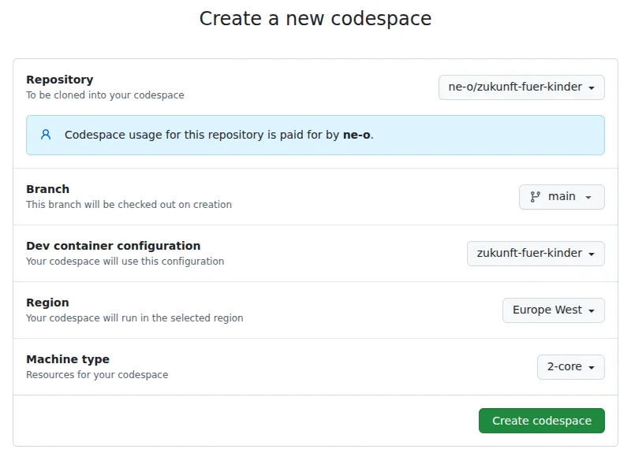

VS Code opens in your browser and the container is built - about 3
minutes the first time. While it builds, the window is mostly empty; a
"Copilot Chat" panel on the right disappears once the codespace is
connected (this project switches GitHub's AI features off - opencode is
the assistant here).

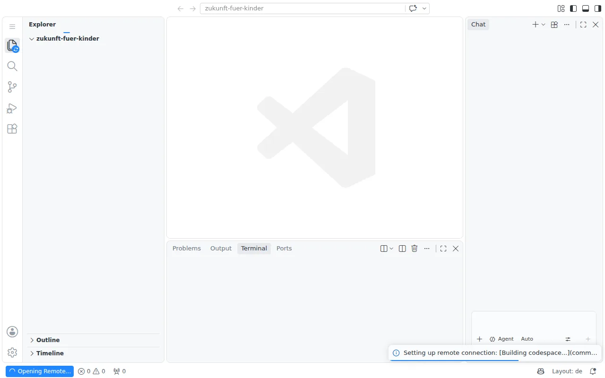

## 3. First start: trust the folder, allow opencode

**Trust the folder.** VS Code first opens the project in "Restricted Mode"
and asks whether you trust the authors of the files. Click **Trust Folder
& Continue** - otherwise terminals, the preview and opencode don't work.
Only do this for repositories you trust (see
[step 10](#10-privacy-and-security)).

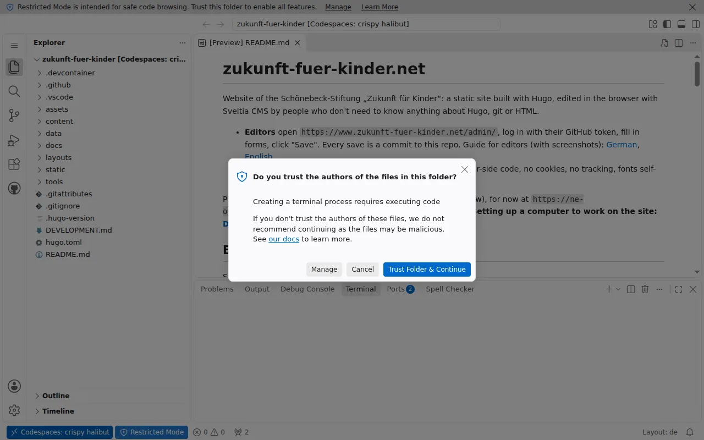

**Allow automatic tasks.** Right after that, a message at the bottom right
asks whether the project may start tasks automatically - here: opencode.
Click **Allow**. (VS Code applies this to all folders you trust, not only
this one.)

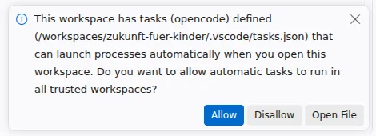

The message **disappears after a few seconds**. Missed it? Click the bell
at the bottom right - it's still there:

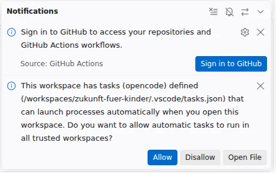

Or: `F1` -> type "Manage Automatic Tasks" -> **Allow Automatic Tasks**,
then `F1` -> "Developer: Reload Window".

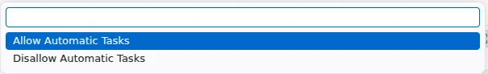

Afterwards opencode starts by itself in the terminal at the bottom - now
and every time you open the codespace:

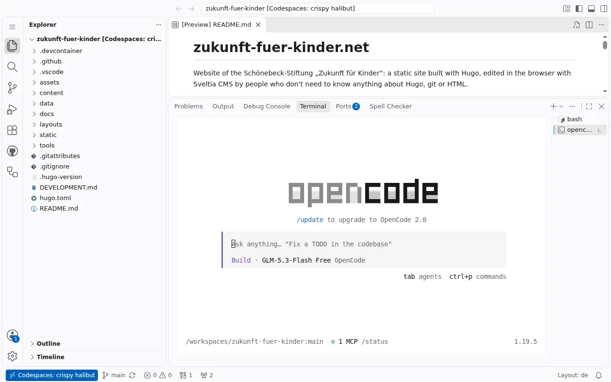

## 4. opencode, the AI assistant

opencode starts with **GLM 5.3 Flash**, free through opencode's own
service and without an account. Type your request into the box and press
Enter. `/models` switches the model; `ctrl+p` shows all commands.

- **"Free usage exceeded"** in red: the free model has run out. In a
  codespace that happens quickly, presumably because many codespaces
  share the same internet addresses. Use your own provider account then:
  `/connect` inside opencode (or `opencode auth login` in a terminal),
  pick the provider, paste your API key. The key stays in your codespace
  (see [step 10](#10-privacy-and-security)).
- opencode remembers the model you picked last.
- Closed opencode? `F1` -> "Tasks: Run Task" -> **opencode**, or type
  `opencode` in any terminal.
- More: [DEVELOPMENT.md](../DEVELOPMENT.md), step 6, and
  <https://opencode.ai/docs/>.

## 5. Preview the site

Open a second terminal (**+** at the top right of the terminal panel) and
start the preview:

    preview

It prints the preview's address. VS Code also shows a message "running on
port 1314 is available" with **Open in Browser**. You'll find the
addresses at any time in the **Ports** tab of the bottom panel (if the
panel is narrow, it hides behind **...**):

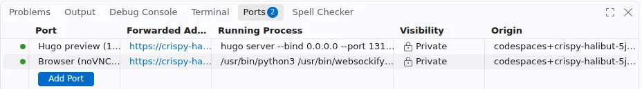

Click the address in the line **Hugo preview** (or the globe icon that
appears when you point at it). The preview opens in a new browser tab -
reachable only for you, after the GitHub login:

Changes you save show up in that tab by themselves after a second or two.
`Ctrl+C` in the terminal stops the preview.

Not available in a codespace: the CMS's "Work with Local Repository" mode
(it needs a folder on your own computer). Test CMS changes on your own
computer or on a branch.

## 6. The shared browser

opencode can drive a browser inside the codespace - open the preview,
click through pages, take screenshots. You watch and click along: in the
**Ports** tab, open the address in the line **Browser (noVNC)** and add
`vnc.html?autoconnect=1&resize=scale` to it, e.g.
`https://<your-codespace>-6080.app.github.dev/vnc.html?autoconnect=1&resize=scale`.

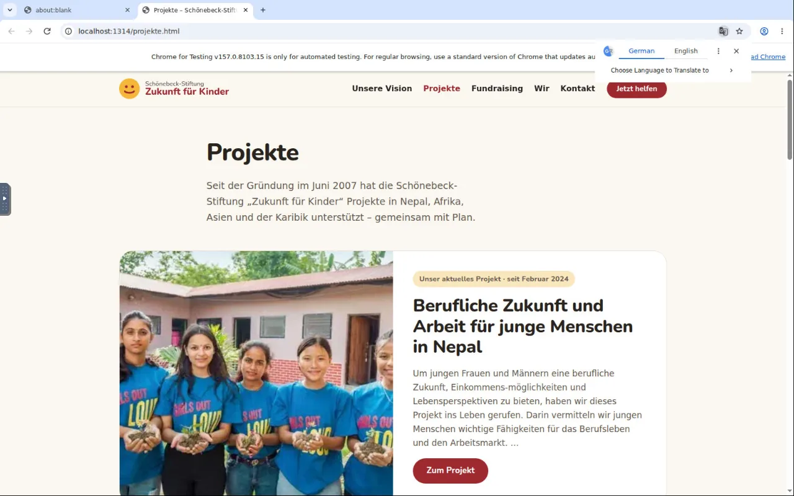

opencode starts that browser by itself. To start it yourself or open an
address in it, type in a terminal (with the preview running):

    browser http://localhost:1314

## 7. Commit and publish your changes

Your changes live in the codespace until you commit and push them - just
like on your own computer: **Source Control** on the left (the branch
icon, `Ctrl+Shift+G`), enter a message, **Commit**, then **Sync
Changes**. Or in a terminal: `git add ...`, `git commit`, `git push`.

- **With write access:** the push goes to the repository; a push to `main`
  publishes the site (README, "Publishing").
- **Without write access:** on the first push, VS Code offers to create a
  **fork** (your own copy) and pushes there. Then open a pull request on
  GitHub; the owner reviews and merges it.

Details: <https://docs.github.com/en/codespaces/developing-in-a-codespace/using-source-control-in-your-codespace>

## 8. Stop, resume, delete

All your codespaces are listed at **<https://github.com/codespaces>**:

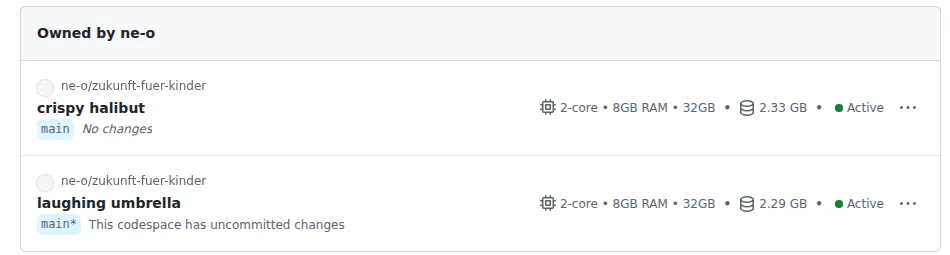

- **Active** = running, uses compute hours. A codespace **stops by
  itself** after 30 minutes without activity. Stop it right away: the
  **...** at the end of its line -> **Stop codespace** (or close the
  browser tab and let it time out).
- **Resume:** click its name; everything is as you left it, including
  uncommitted changes and your opencode login.
- **Delete:** **...** -> **Delete**. Commit and push first - uncommitted
  changes are lost ("This codespace has uncommitted changes" warns you).
  Stopped codespaces still use storage; GitHub deletes them after 30 days
  without use.
- **Other options in the ...** menu: "Export changes to a branch" (saves
  uncommitted work without a push), "Change machine type", "Open in
  Visual Studio Code" (desktop app instead of the browser).

The 30 minutes and 30 days are adjustable for all your codespaces at
<https://github.com/settings/codespaces> - a shorter idle timeout saves
compute hours:

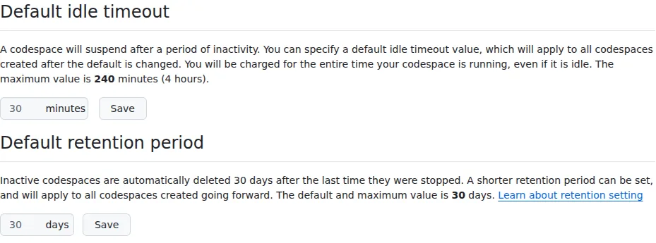

## 9. How much of the free quota is left?

**<https://github.com/settings/billing/summary>** (your picture at the top
right -> **Settings** -> **Billing and licensing** -> **Overview**). Under
**Metered usage -> Usage by products**, click **Codespaces**: "consumed
usage" is what you used this month, "discounts" the part covered by the
free quota - as long as **Billable usage** shows **$0**, you're within the
quota.

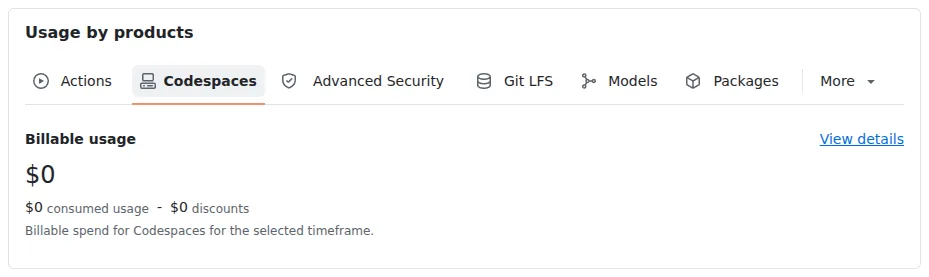

**View details** (or **Billing and licensing -> Usage**, filtered by
`product:codespaces`) breaks it down into compute hours and storage. New
usage shows up there with a delay of a few hours, not immediately.

## 10. Privacy and security

- **Your codespace is private.** Nobody else - not even the repository
  owner - can see its files, terminals or forwarded ports. It runs on a
  machine in GitHub's (Microsoft's) cloud.
- **Keep ports private.** In the Ports tab, "Visibility: Private" means
  only you, after the GitHub login. Never switch a port to **Public** -
  especially not **Browser (noVNC)**: anyone with the link could then use
  that browser.
- **API keys** you enter in opencode are stored in the codespace only and
  disappear when you delete it. Prompts and files you give opencode go to
  the provider of the chosen model. Revoke keys at the provider when you
  no longer need them; set a spending limit there.
- **Only trust repositories and branches you know.** A codespace runs what
  `.devcontainer/` in the chosen branch says - a modified one could read
  your keys. So don't start codespaces from strangers' forks or branches
  while logged in to a provider, and check changes to `.devcontainer/`
  in pull requests carefully.

## 11. Troubleshooting

| Problem | Fix |
|---|---|
| Terminal, preview or opencode don't work, "Restricted Mode" at the bottom left | The folder isn't trusted yet: click "Restricted Mode" -> **Trust**. |
| opencode didn't start | Missed the automatic-tasks message: see [step 3](#3-first-start-trust-the-folder-allow-opencode), or start it with `opencode` in a terminal. |
| "Free usage exceeded" in opencode | See [step 4](#4-opencode-the-ai-assistant): use your own provider account. |
| Preview page without styles, links lead nowhere | Start it with `preview`, not plain `hugo server` (it needs the codespace's address). |
| Preview doesn't update | Reload the tab; if it still doesn't, `Ctrl+C` in the preview terminal and `preview` again. |
| "Failed to fetch" errors for extensions | An ad or tracking blocker in your browser blocks VS Code's extension marketplace. Allow it for `github.dev`, or use a private window without extensions. The project's own extensions are installed regardless. |
| Codespace won't start or resume, quota used up | See [step 9](#9-how-much-of-the-free-quota-is-left); wait for next month or delete unused codespaces (storage). |
| Something's broken in the container itself | `F1` -> "Codespaces: Rebuild Container". Your files in the project folder stay; commit and push first to be safe. |
