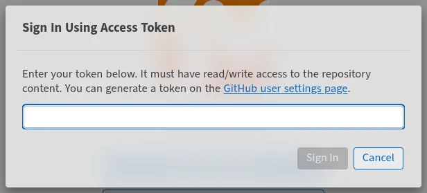
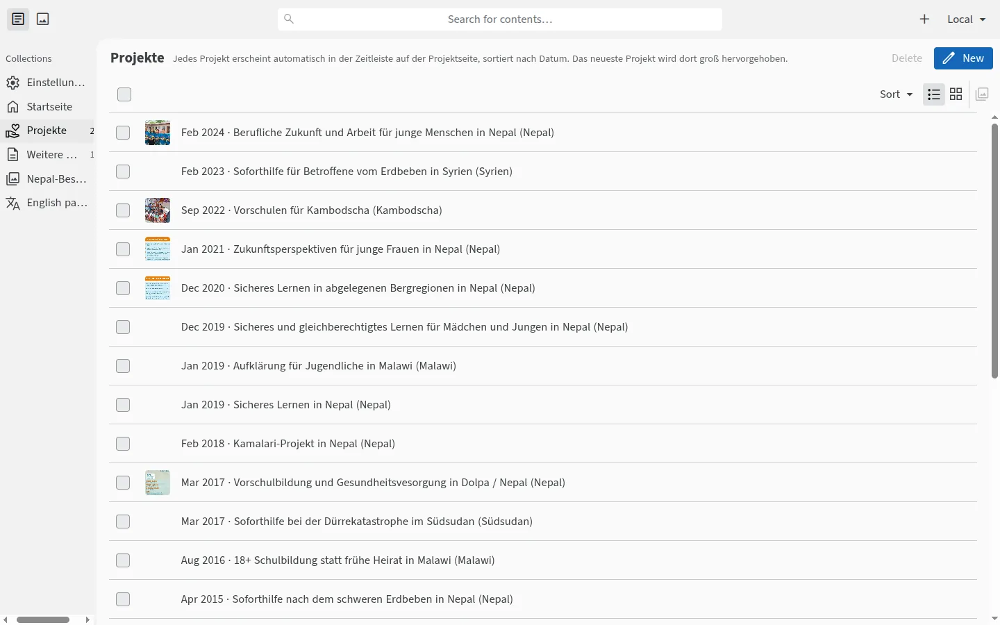
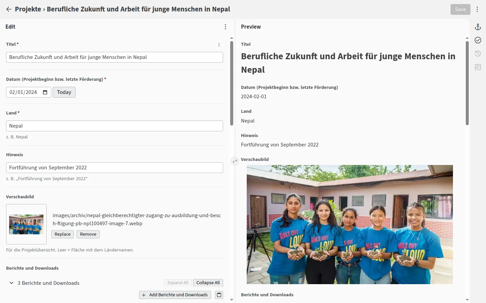
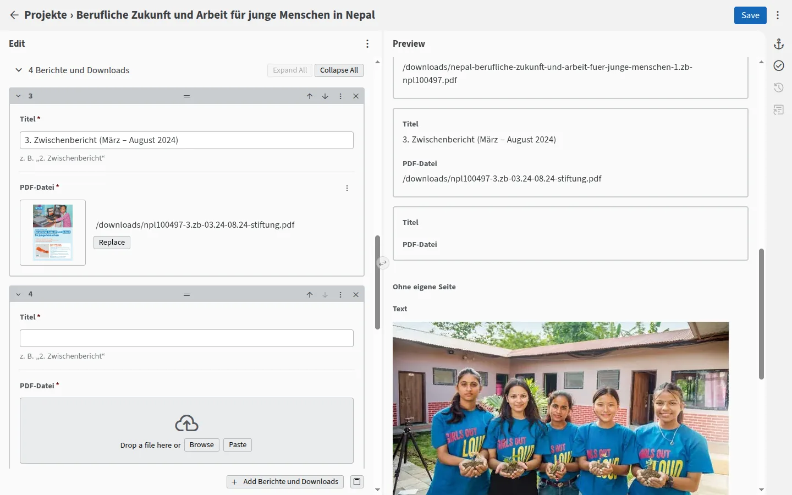
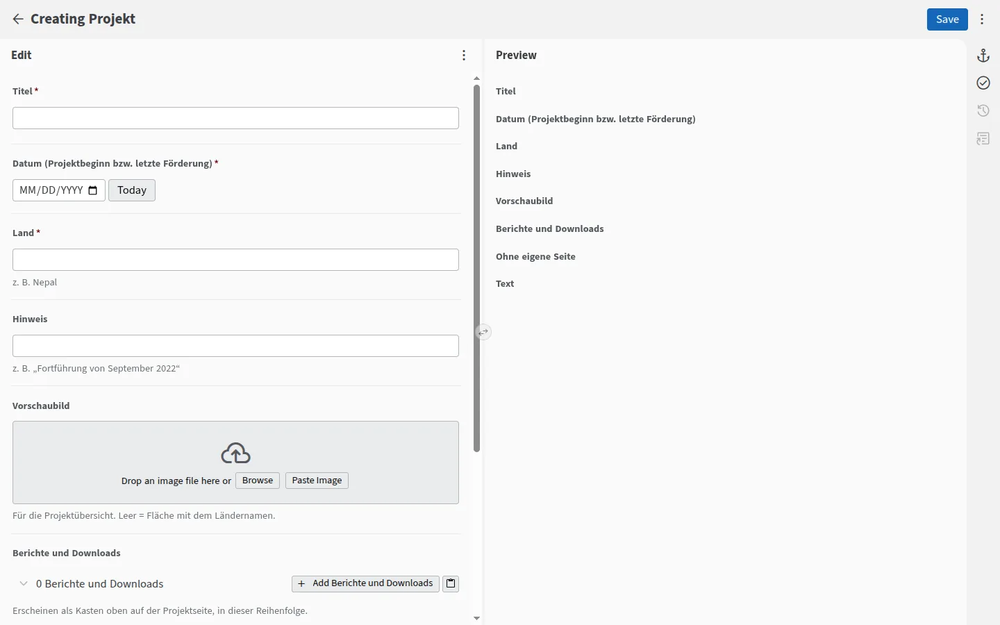
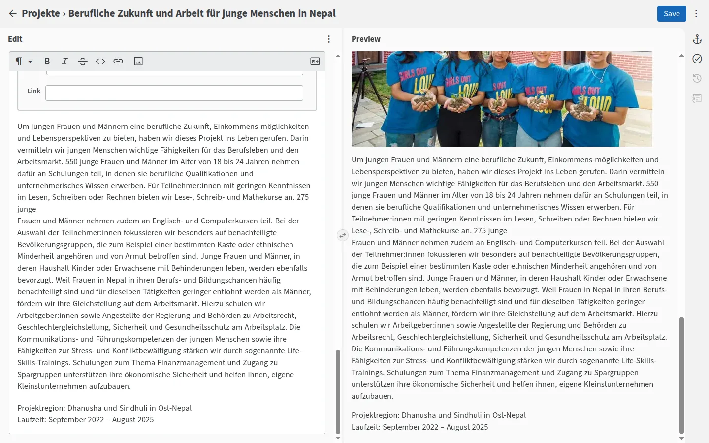
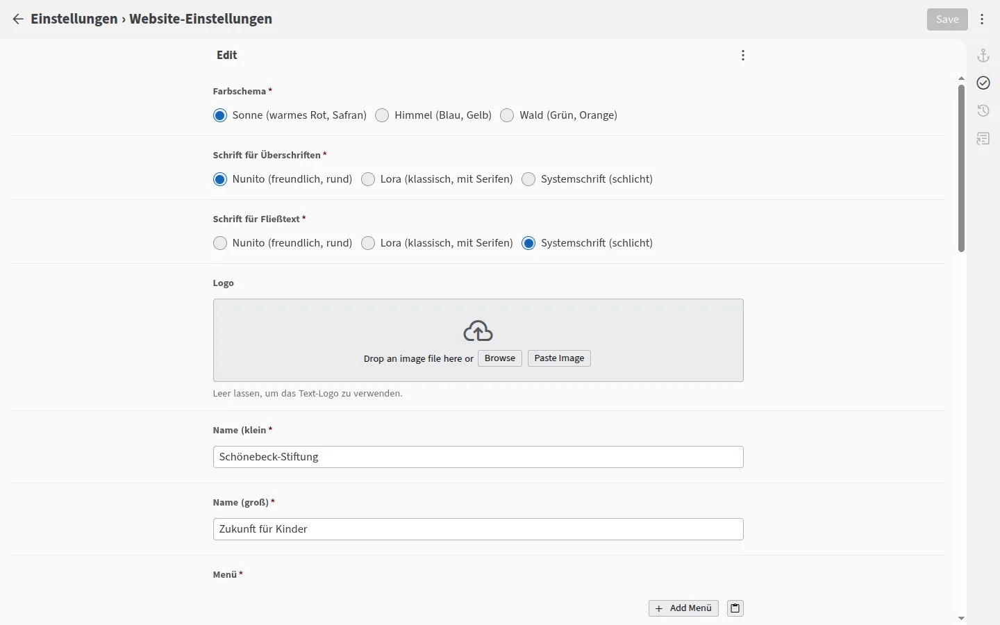

# Editor guide

How to change texts, photos and reports on the „Zukunft für Kinder“
website. All you need is a browser (Chrome, Edge, Firefox or Safari). No
HTML or programming knowledge needed.

*Deutsche Fassung: [anleitung-redaktion.md](anleitung-redaktion.md)*

**Editing area:** <https://ne-o.github.io/zukunft-fuer-kinder/admin/>
(once the domain has moved: `https://www.zukunft-fuer-kinder.net/admin/`)

> The editor's interface is in English, the forms are in German. German
> field names are given here with a translation, e.g. **Titel** (title).

## Contents
1. [Once: set up access](#1-once-set-up-access)
2. [Signing in](#2-signing-in)
3. [Overview](#3-overview)
4. [Editing a project](#4-editing-a-project)
5. [Uploading a report (PDF)](#5-uploading-a-report-pdf)
6. [Creating a new project](#6-creating-a-new-project)
7. [Text and photos in the text field](#7-text-and-photos-in-the-text-field)
8. [Other pages and settings](#8-other-pages-and-settings)
9. [Good to know](#9-good-to-know)

## 1. Once: set up access
The website is stored on GitHub. Every editor signs in with their own
GitHub account.

1. **Create a GitHub account** (free) at <https://github.com/signup> if
   you don't have one.
2. **Hide your email address:** every change is saved under your GitHub
   account and is publicly visible. To keep your email address out of it,
   open <https://github.com/settings/emails> and tick **Keep my email
   addresses private**.
3. **Accept the invitation:** send your GitHub user name to the person
   who looks after the website technically. You'll get an email from
   GitHub inviting you to the project `ne-o/zukunft-fuer-kinder` - accept
   it (**Accept invitation**).
4. **Create an access token:** open
   <https://github.com/settings/tokens/new> (menu: Settings -> Developer
   settings -> Personal access tokens -> **Tokens (classic)** ->
   **Generate new token (classic)**).
   - **Note:** a name to remember it by, e.g. `Website Zukunft für Kinder`.
   - **Expiration:** an expiry date, e.g. 1 year. Write it down - after
     that you create a new token (see [Good to know](#9-good-to-know)).
   - **Select scopes:** tick only **public_repo** (under "repo"). Leave
     everything else unticked.
   - Click **Generate token** at the bottom.
5. **Copy the token:** GitHub shows it (starts with `ghp_`) **only
   once**. Copy it right away. You need it to sign in; after that your
   browser remembers the login. Keep it like a password (e.g. in a
   password manager) and never share it.

Use the **"classic"** kind. The other kind ("fine-grained") doesn't work
for this project.

## 2. Signing in
Open the editing area (address above) and click **Sign In Using Access
Token**. Paste your token and click **Sign In**.

Next time you'll usually still be signed in, in the same browser.

## 3. Overview
The sections of the website are listed on the left:

| Section | What you change there |
|---|---|
| **Einstellungen** (settings) | colours, fonts, logo, menu, contact, bank account - for the whole website |
| **Startseite** (start page) | texts, photos, facts and cards of the start page |
| **Projekte** (projects) | one entry per project, with reports (PDF) |
| **Aktuelles (Beiträge)** (news posts) | one entry per news item (fundraiser, event, project report …) |
| **Weitere Seiten** (other pages) | vision, about us, how to help, contact, legal notice, privacy etc. |
| **Nepal-Besuch 2016 (Unterseiten)** | the pages of the 2016 trip report |
| **English pages** | the English versions of the main pages (same fields as in German) |

Click an entry to open it. The search box at the top finds text on all
pages.

*(The pictures in this guide come from a test setup, so the top right
says "Local". You'll see your GitHub profile picture there.)*

## 4. Editing a project
1. Choose **Projekte** on the left, click the project.
2. The fields are on the left, a simple preview on the right.
3. Change what's needed. Fields marked `*` are required.
4. Click **Save** at the top right.

**After saving**, the change shows up on the website after about **1-2
minutes**. Then reload the page (F5).

A project's fields:
- **Titel** (title), **Land** (country) - shown in the project overview.
- **Datum** (date) - sets the order in the timeline on the projects
  page.
- **Aktuelles Projekt** (current project) - tick it for the project we are
  raising money for right now: it is shown large on the start page, the
  projects page and the donation page. Tick only one; if several are
  ticked, the newest counts.
- **Hinweis** (note) - a short addition, e.g. "Fortführung von September
  2022".
- **Vorschaubild** (preview image) - photo for the project overview.
  Without one, a coloured box with the country name is shown.
- **Berichte und Downloads** (reports and downloads) - see the next
  section.
- **Ohne eigene Seite** (no page of its own) - only for entries that
  should be in the timeline without a project page of their own. Usually
  leave it alone.
- **Text** - the project text itself, with photos.

The arrow at the top left (**←**) takes you back to the list. If you
didn't save, nothing changes.

## 5. Uploading a report (PDF)
1. Open the project and scroll down to **Berichte und Downloads**.
2. Click **Add Berichte und Downloads** - a new, empty entry appears at
   the bottom.
3. Fill in the **Titel**, e.g. "4. Zwischenbericht (September 2024 -
   Februar 2025)".
4. For **PDF-Datei** (PDF file), drag the file onto the grey box or click
   **Browse** and pick it.
5. Click **Save** at the top right.

The reports appear in a box at the top of the project page, in the order
of the list. The arrows **↑ ↓** in an entry's grey bar change the order,
**✕** removes it.

**Tip:** the file name becomes part of the PDF's address. Give the file a
sensible name before uploading, e.g.
`nepal-berufliche-zukunft-4-zwischenbericht.pdf` (no umlauts, no spaces).

## 6. Creating a new project
1. Choose **Projekte** on the left, click **New** at the top right.
2. Fill in at least **Titel**, **Datum** and **Land**, plus the **Text**
   and ideally a **Vorschaubild**.
3. Click **Save** at the top right.

The project appears in the timeline on the "Projekte" page by itself,
sorted by date. The new page's address is made from the title. If you
change the title later, the address stays the same.

## 7. Text and photos in the text field
The **Text** field works like a simple word processor:

- Toolbar: **¶** paragraph/heading, **B** bold, *I* italic, link (chain
  icon), photo (image icon).
- **Adding a link:** select the text, click the chain icon, enter the
  address. For pages of this website the part after the domain is
  enough, e.g. `/projekte.html`.
- **Adding a photo:** click the image icon and upload a photo. Always add
  a short **image description** (for blind people and search engines).
- **Photos as a gallery:** several photos right after each other in the
  same paragraph are shown side by side as a gallery on the website. A
  click enlarges them.
- Photos may be large (e.g. straight from a phone): they're shrunk
  automatically on upload. The larger the original, the sharper the
  enlarged view.

## 8. Other pages and settings
- **Startseite** and **Weitere Seiten** work just like a project. New
  general pages can't be created here - only new projects and news
  posts. Ask the person who looks after the website for that.
- **Aktuelles (Beiträge)** (news posts): **New** creates a news item.
  Each post appears as a card on the "Aktuelles" page (newest first) and
  gets a page of its own. The **Kurzfassung** (summary) is shown on the
  card; **Erlös für Projekt** (proceeds for project) optionally links the
  project the money went to. Without a photo, a coloured box is shown.
- **Weitere Seiten -> Aktuelles**: the upcoming events and, below them,
  the older news. When an event is over, delete it there and create a
  post about it.
- **English pages**: the English pages have the same fields as the
  German ones. When you change a German main page, please remember the
  English version too. Links to English pages start with `/en/` (e.g.
  `/en/how-to-help.html`). Projects and news exist in German only; for the
  English project overview, each project has the field **Titel
  (Englisch)** (English title).
- **Einstellungen -> Website-Einstellungen** applies to the **whole**
  website: colour scheme, fonts, logo, menu, donate button, contact and
  bank account. The colour schemes are checked for readability. Please
  only change these after agreeing on it.

## 9. Good to know
- **Every save goes public right away** (after 1-2 minutes). There's no
  draft mode. But you can't break anything for good: every earlier
  version is kept and can be restored by the person who looks after the
  website.
- **Deleting:** deleted projects or pages disappear together with their
  address; links from other websites to them stop working. Please agree
  on it first.
- **Email from GitHub "Run failed":** after saving, the website is
  checked automatically. If the check finds e.g. a link that leads
  nowhere, the change is **not** published and GitHub sends you this
  email. The website stays as it was. Forward the email to the person
  who looks after the website, or fix the link and save again.
- **Token expired:** if signing in no longer works or saving stops with
  an error, the token has usually expired. Create a new one as in
  [section 1](#1-once-set-up-access), steps 4-5, and sign in with it. You
  can delete the old one at <https://github.com/settings/tokens>. GitHub
  reminds you by email shortly before.
- **Error when saving even with a new token:** let the person who looks
  after the website know (with a screenshot of the message).
- **Signing out** (e.g. on someone else's computer): click your profile
  picture at the top right -> **Sign Out**.
- **Date:** the date field uses your browser's format (e.g. DD.MM.YYYY).
  **Today** sets today's date.
